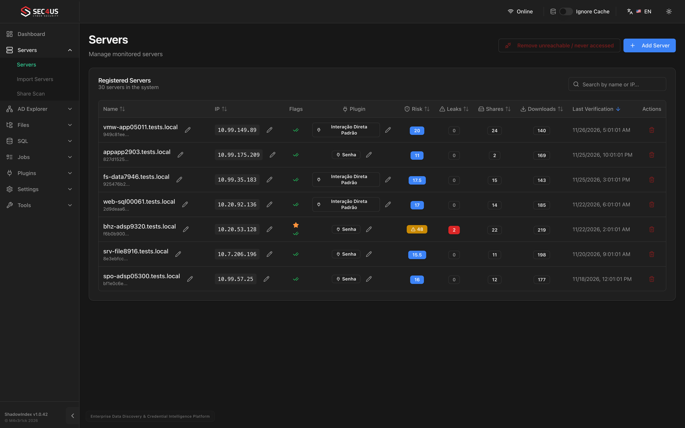
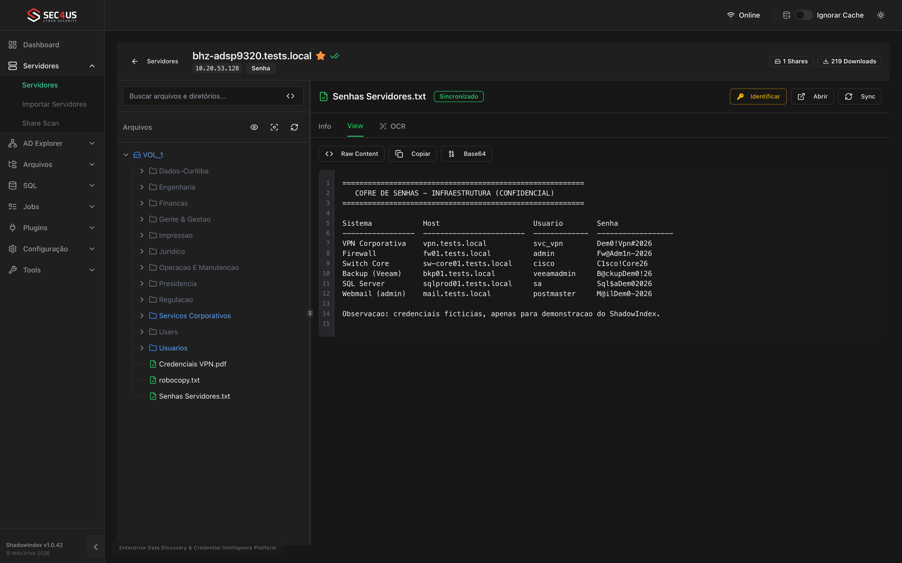
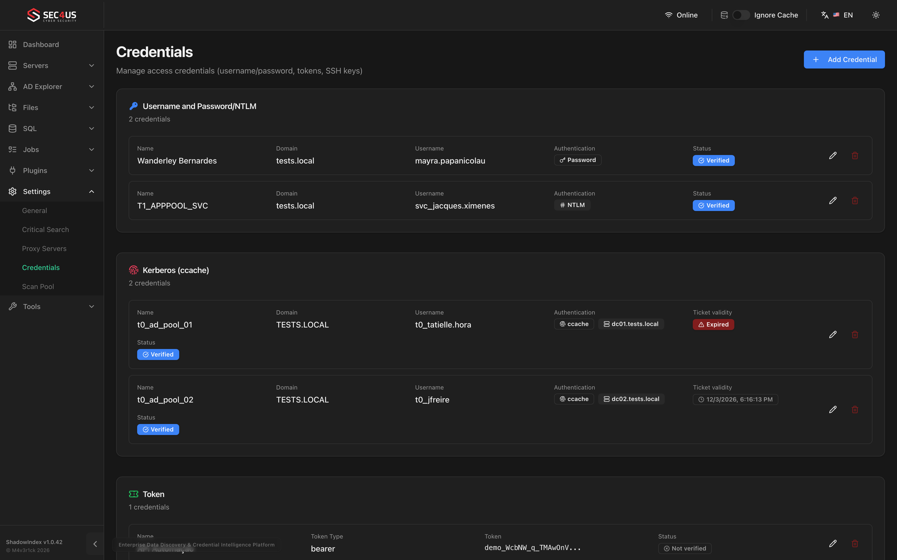
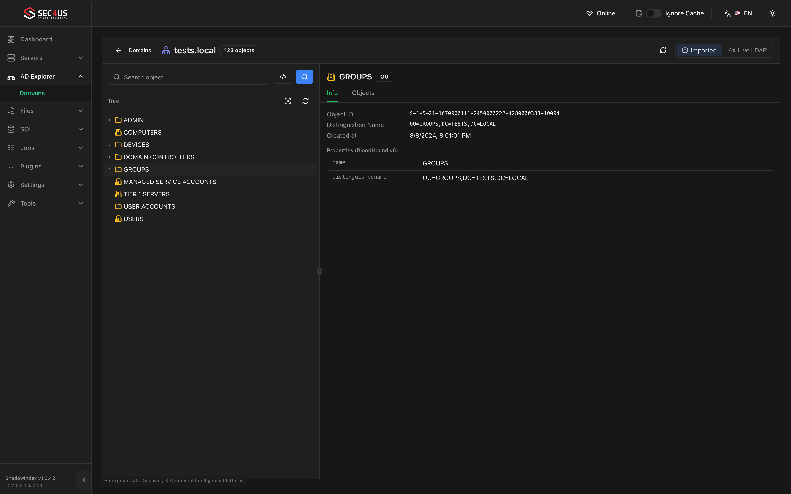
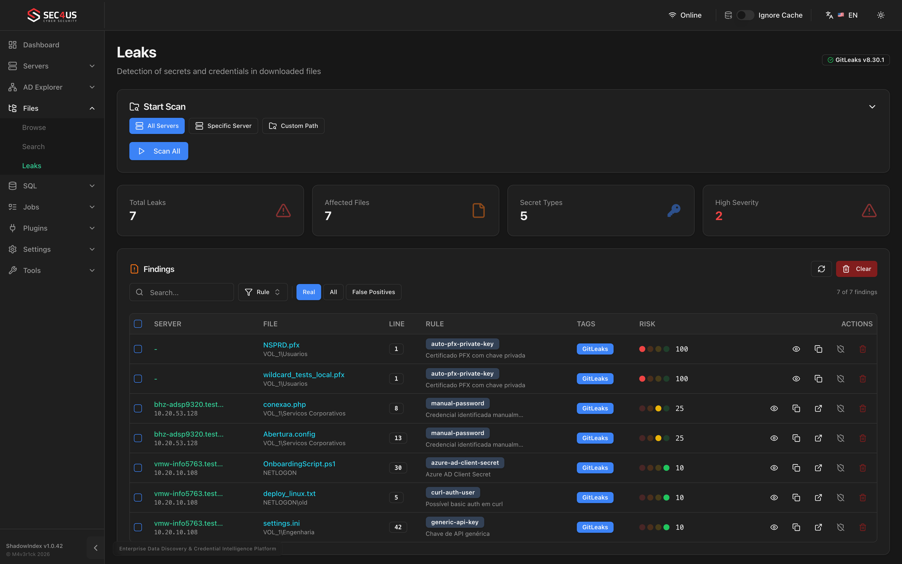

# ShadowIndex

> **Enterprise Data Discovery & Credential Intelligence Platform**

[](LICENSE)

ShadowIndex helps security teams discover and analyze sensitive data across a
network. It browses SMB shares, downloads and indexes files (with OCR), detects
secrets and credential *leaks*, explores Active Directory, and runs queries
against discovered databases — all from a single web interface.

Everything collected from a server — **downloaded files, their content and the
extracted OCR text** — is **stored locally**, so you can view, search and browse
it **offline**, even when the source server is no longer reachable.

## 📖 Documentation

Full usage guide (one page per feature, in **English** and **Português**) is on
the **[Project Wiki »](https://github.com/helviojunior/shadowindex/wiki)**.

## ✨ Main Features

- **Server inventory** — monitor servers with a per-host risk index, leaks,
  shares and downloads; import from Nmap, IP/host lists or BloodHound.
- **File browser** — navigate SMB shares, view file content (text, Base64, and a
  built-in **PDF viewer**), read **OCR** text, and keep everything for **offline**
  analysis.
- **Credentials** — user/password, **NTLM (hash)**, **Kerberos (ccache)**, token
  and SSH keys, with verification status.
- **Proxy support** — reach the target network through **SOCKS5 (Proxychains)** or
  **HTTP** proxies, with DNS over the tunnel.
- **AD Explorer** — explore the Active Directory tree per domain (BloodHound v6
  import or live LDAP), with full object properties.
- **Leaks detection** — find secrets and credentials in downloaded files with
  **GitLeaks** + Critical Search (SSH keys, PFX/private keys, passwords, tokens…).
- **SQL** — connect to databases (MS-SQL, MySQL, PostgreSQL, Oracle, and more),
  run enumeration queries and keep a history.
- **Dashboard & OCR pipeline** — overview metrics plus automatic OCR/indexing via
  Apache Tika.

## 📸 Screenshots



| Files & content (offline) | Credentials | AD Explorer | Leaks |
|---|---|---|---|
|  |  |  |  |

> More screenshots and feature walkthroughs are in the
> [Wiki](https://github.com/helviojunior/shadowindex/wiki). Screens use
> **fictitious** demo data (`tests.local`).

## 🚀 Getting Started (Docker)

```bash
git clone https://github.com/helviojunior/shadowindex.git
cd shadowindex
docker compose up -d --build
```

- Web UI: `http://localhost:3000`
- Backend API: `http://localhost:9090`

To expose the backend on another host, set `REACT_APP_BACKEND_URL` at build time
(it is injected into the React build):

```bash
REACT_APP_BACKEND_URL=http://YOUR_IP:9090 docker compose up -d --build --force-recreate
```

For a development stack with hot reload and a SOAP mock server:

```bash
docker compose -f docker-compose.dev.yml up -d --build
```

See the [Wiki](https://github.com/helviojunior/shadowindex/wiki) for detailed
configuration (database, ports, OCR, proxies, etc.).

## 🧰 Tech Stack

- **Backend:** FastAPI · PostgreSQL/SQLite (SQLAlchemy + asyncpg/aiosqlite) ·
  Apache Tika (OCR) · GitLeaks · Python 3.11
- **Frontend:** React · Tailwind CSS · shadcn/ui · Axios · Lucide Icons
- **Infra:** Docker Compose · Nginx

## ⚠️ Disclaimer

ShadowIndex is intended for **authorized security assessments only** (e.g.
penetration tests, red/blue team exercises and internal audits you are
explicitly permitted to perform). Using it to access systems, shares, Active
Directory, databases or data **without the owner's explicit authorization may be
illegal**. You are solely responsible for ensuring you have proper permission.
The authors and contributors accept **no liability** for misuse or for any
damage caused by this tool.

## 📄 License

Licensed under the **BSD 2-Clause License**. See [LICENSE](LICENSE) for details.

© 2022 Helvio Junior
