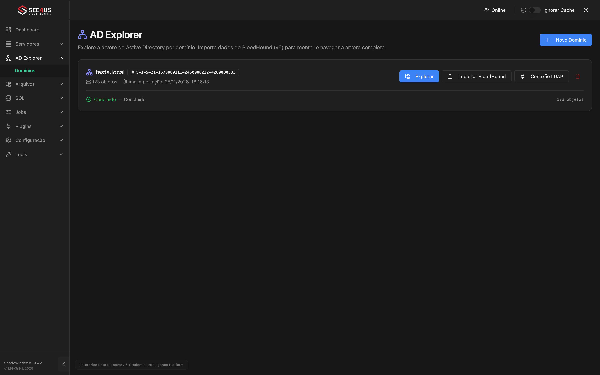
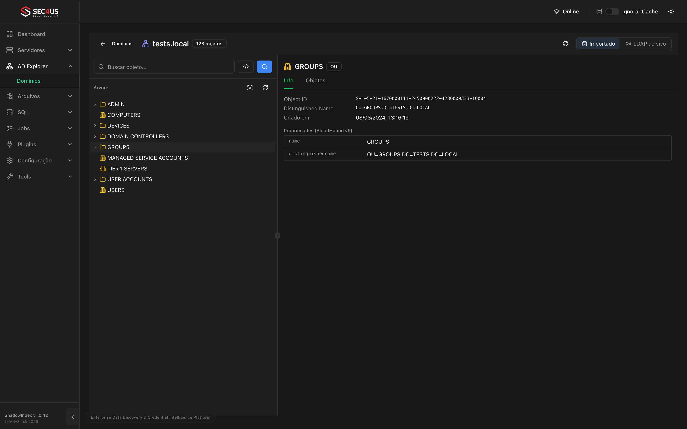

# AD Explorer

[🏠 Home](Home) · [🇧🇷 Português](AD-Explorer-PT)

Explore the **Active Directory** tree per domain, importing **BloodHound** data
or querying **live LDAP**.

## What it shows

- List of **domains** with SID, object count and last import date.
- For each domain: **Explore** the tree, **Import BloodHound** (v6) or open an
  **LDAP Connection**.
- Import/scan jobs with status (e.g. *Completed*).

## Browsing the tree

- Tree of **OUs, users, computers and groups** in the **BloodHound v6** format.
- Details panel with **Object ID**, **Distinguished Name**, creation date and all
  properties (enabled, highvalue, SPNs, delegation, etc.).
- Object search and toggle between **Imported** and **live LDAP** data.

## How to use

1. **New Domain** — provide the FQDN (e.g. `tests.local`).
2. **Import BloodHound** (v6 file/zip) to build the tree, **or** use **LDAP
   Connection** with a [credential](Credentials-EN) (and optionally a
   [proxy](Proxy-Servers-EN)).
3. Click **Explore** and navigate the OUs; select an object to see its
   properties.
4. Use search to locate accounts (e.g. `admin`, `t0`).
