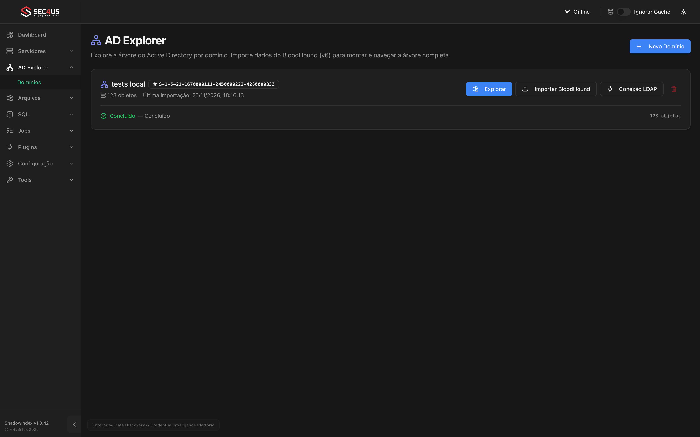
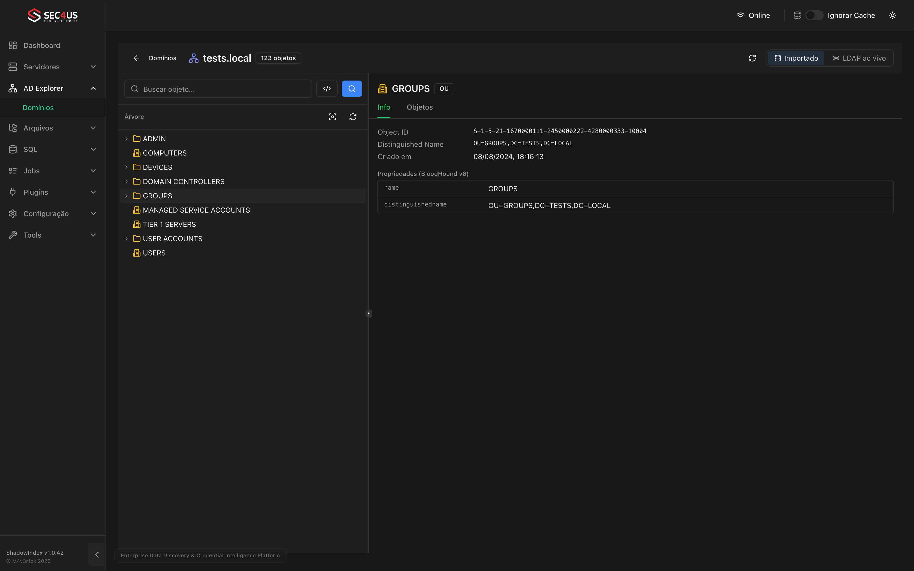

# AD Explorer

[🏠 Início](Home) · [🇺🇸 English](AD-Explorer-EN)

Explore a árvore do **Active Directory** por domínio, importando dados do
**BloodHound** ou consultando o **LDAP ao vivo**.

## O que mostra

- Lista de **domínios** com SID, número de objetos e data da última importação.
- Para cada domínio: **Explorar** a árvore, **Importar BloodHound** (v6) ou abrir
  uma **Conexão LDAP**.
- Jobs de importação/varredura com status (ex.: *Concluído*).

## Navegando a árvore

- Árvore de **OUs, usuários, computadores e grupos** no padrão **BloodHound v6**.
- Painel de detalhes com **Object ID**, **Distinguished Name**, data de criação e
  todas as propriedades (enabled, highvalue, SPNs, delegação, etc.).
- Busca por objeto e alternância entre dados **Importados** e **LDAP ao vivo**.

## Como usar

1. **Novo Domínio** — informe o FQDN (ex.: `tests.local`).
2. **Importar BloodHound** (arquivo/zip v6) para montar a árvore, **ou** use
   **Conexão LDAP** com uma [credencial](Credenciais-PT) (e opcionalmente um
   [proxy](Proxy-Servers-PT)).
3. Clique em **Explorar** e navegue pelas OUs; selecione um objeto para ver suas
   propriedades.
4. Use a busca para localizar contas (ex.: `admin`, `t0`).
