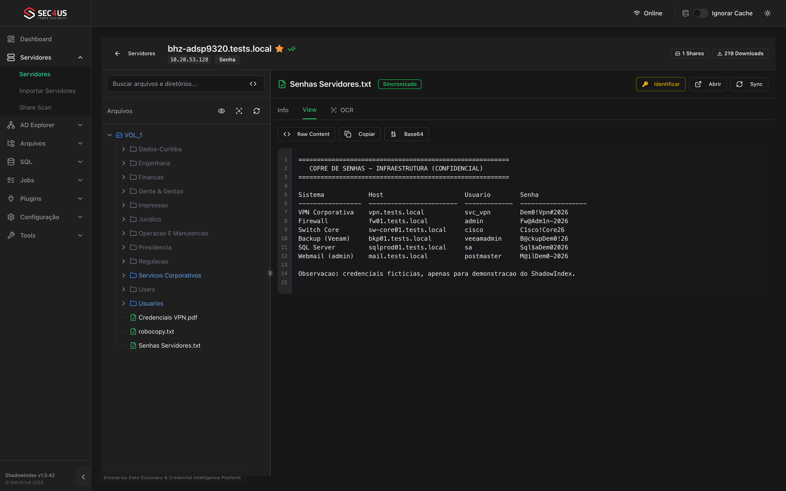
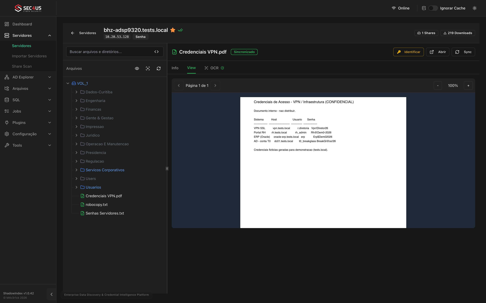

# Arquivos (Browse, OCR e Offline)

[🏠 Início](Home) · [🇺🇸 English](Files-EN)

Navegue pelos compartilhamentos (shares) de um servidor, visualize o conteúdo
dos arquivos e consulte o texto extraído por OCR.

## Armazenamento local e visualização offline

Todos os dados coletados — **arquivos baixados, seu conteúdo e o texto de OCR** —
ficam **armazenados localmente** (em `shadowindex_data/`). Assim é possível
**visualizar, pesquisar e navegar offline**, mesmo que o servidor de origem
esteja indisponível.

## O que mostra

- **Árvore de shares e diretórios** (ex.: `VOL_1`), com busca por nome de arquivo
  ou diretório e modo "foco" na seleção.
- Painel do arquivo com três abas:
  - **Info** — caminho UNC, tamanho, hash SHA-1, MIME type, versões e status.
  - **View** — conteúdo do arquivo (texto cru, Base64) e, para PDFs, o
    **visualizador integrado**.
  - **OCR** — texto extraído (via Tika) de documentos e imagens.

### Visualização de PDF

## Como usar

1. Em **[Servidores](Servidores-PT)**, clique em um servidor para abrir o browse.
2. Expanda um share (ex.: `VOL_1`) e navegue pela árvore de pastas.
3. Selecione um arquivo baixado para ver **Info**, **View** e **OCR**.
4. Use **Identificar** para registrar manualmente um leak no arquivo, ou
   **Sync** para atualizar/baixar o conteúdo.
5. Use a busca para localizar arquivos por nome (ex.: `senha`, `.pfx`).

## Relacionado

- [Servidores](Servidores-PT) · [Leaks](Leaks-PT)
