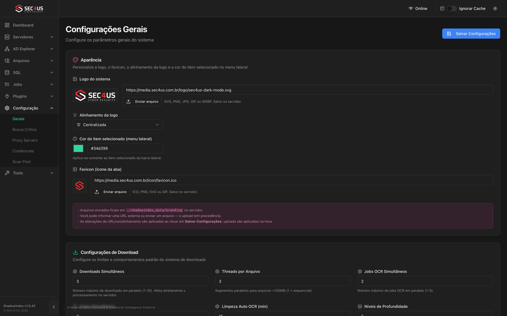

# Configurações

[🏠 Início](Home) · [🇺🇸 English](Settings-EN)

Parâmetros gerais do sistema — aparência, downloads, OCR e integrações.

## Seções

- **Aparência** — logo do sistema, favicon, **alinhamento da logo** e cor do item
  selecionado no menu lateral. Uploads ficam em `shadowindex_data/branding`.
- **Download** — downloads simultâneos, threads por arquivo, jobs de OCR
  simultâneos, tamanho máximo e extensões ignoradas.
- **OCR / Indexação** — habilitar OCR automático, extensões e MIME types
  incluídos/excluídos, auto-indexação de conteúdo bruto.
- Subpáginas: **[Busca Crítica](Leaks-PT)**, **[Proxy Servers](Proxy-Servers-PT)**,
  **[Credenciais](Credenciais-PT)** e **Scan Pool** (concorrência e filtros dos
  scans de share).

## Como usar

1. Ajuste os campos desejados.
2. Clique em **Salvar Configurações** (uploads de logo/favicon são aplicados na
   hora; URLs/cor/alinhamento ao salvar).
