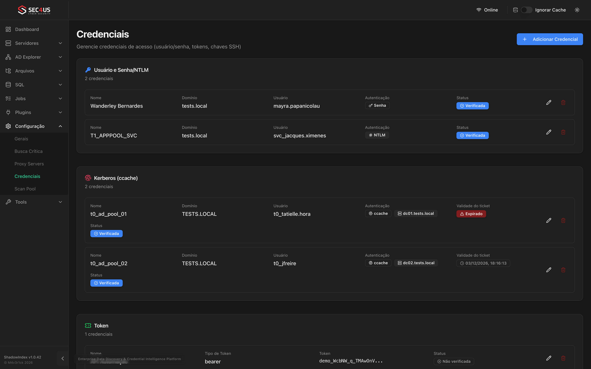

# Credenciais

[🏠 Início](Home) · [🇺🇸 English](Credentials-EN)

Gerencie as credenciais de acesso usadas pelos plugins de interação, scans de
share e conexão LDAP.

## Tipos suportados

- **Usuário e Senha** — autenticação por senha em claro.
- **NTLM (hash)** — autenticação *pass-the-hash*, sem senha em claro (campo de
  hash NT).
- **Kerberos (ccache)** — ticket em cache (base64); a tela mostra a
  **validade do ticket** (ex.: *Expirado* ou data de expiração) e o KDC.
- **Token** — *bearer* / API key.
- **Chave SSH** — chave privada (com passphrase opcional).

Cada credencial tem um **status de verificação** (Verificada / Não verificada).

## Como usar

1. **Adicionar Credencial** e escolha o tipo.
2. Informe domínio/usuário e o segredo correspondente (senha, hash NT, ccache,
   token ou chave).
3. A credencial fica disponível para os **plugins de interação**, o
   **[AD Explorer](AD-Explorer-PT)** (conexão LDAP) e os **[Proxies](Proxy-Servers-PT)**.
4. Reutilize a mesma credencial em múltiplos servidores.

> Credenciais são dados sensíveis. Use apenas em ambientes autorizados.
