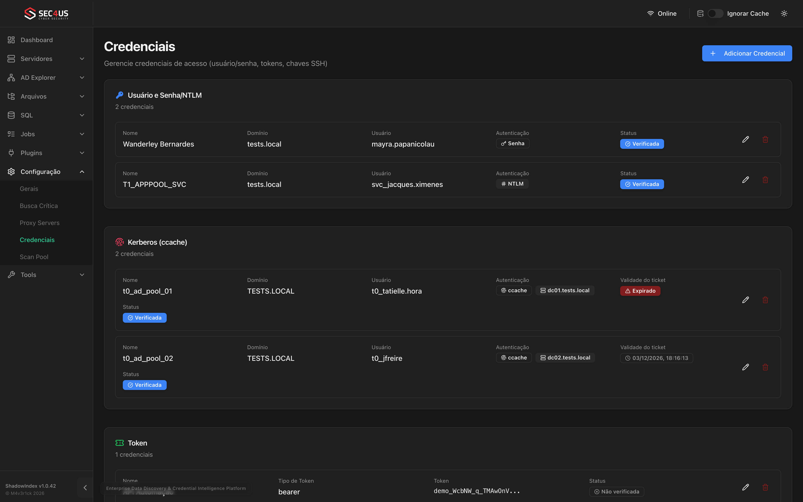

# Credentials

[🏠 Home](Home) · [🇧🇷 Português](Credenciais-PT)

Manage the access credentials used by the interaction plugins, share scans and
LDAP connection.

## Supported types

- **User and Password** — plaintext password authentication.
- **NTLM (hash)** — *pass-the-hash* authentication, no plaintext password (NT
  hash field).
- **Kerberos (ccache)** — cached ticket (base64); the screen shows the
  **ticket validity** (e.g. *Expired* or an expiration date) and the KDC.
- **Token** — *bearer* / API key.
- **SSH key** — private key (with optional passphrase).

Each credential has a **verification status** (Verified / Not verified).

## How to use

1. **Add Credential** and choose the type.
2. Provide domain/user and the matching secret (password, NT hash, ccache, token
   or key).
3. The credential becomes available to the **interaction plugins**, the
   **[AD Explorer](AD-Explorer-EN)** (LDAP connection) and the
   **[Proxies](Proxy-Servers-EN)**.
4. Reuse the same credential across multiple servers.

> Credentials are sensitive data. Use only in authorized environments.
