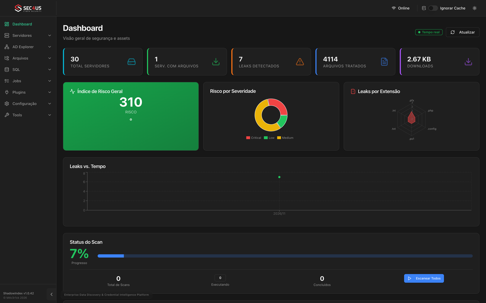

# Dashboard

[🏠 Home](Home) · [🇧🇷 Português](Dashboard-PT)

ShadowIndex landing panel, with an **overview** of the monitored environment.

## What it shows

- Consolidated metrics: total servers, downloaded files, *leaks* found and
  running jobs.
- Status indicators (e.g. **Online/Offline**) and shortcuts to the main areas.
- A quick view of the environment's aggregated risk.

## How to use

1. Open `http://localhost:3000` — the Dashboard is the landing screen.
2. Use the cards and charts to quickly spot where the risk is highest (servers
   with leaks, many exposed shares, etc.).
3. Use the side menu to reach each feature.
