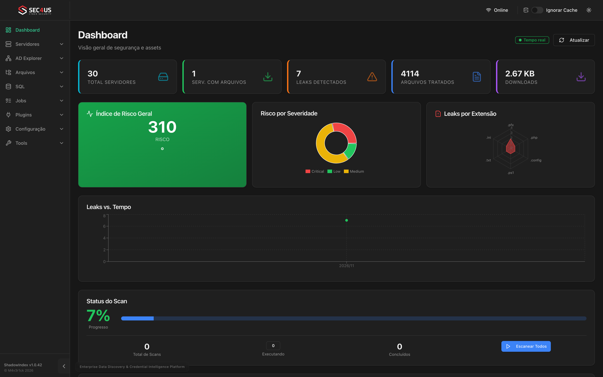

# Dashboard

[🏠 Início](Home) · [🇺🇸 English](Dashboard-EN)

Painel inicial do ShadowIndex, com a **visão geral** do ambiente monitorado.

## O que mostra

- Métricas consolidadas: total de servidores, arquivos baixados, *leaks*
  encontrados e jobs em andamento.
- Indicadores de estado (ex.: **Online/Offline**) e atalhos para as principais
  áreas da ferramenta.
- Visão rápida do risco agregado do ambiente.

## Como usar

1. Acesse `http://localhost:3000` — o Dashboard é a tela inicial.
2. Use os cartões e gráficos para identificar rapidamente onde há mais risco
   (servidores com leaks, muitos shares expostos, etc.).
3. Navegue pelo menu lateral para cada funcionalidade.
