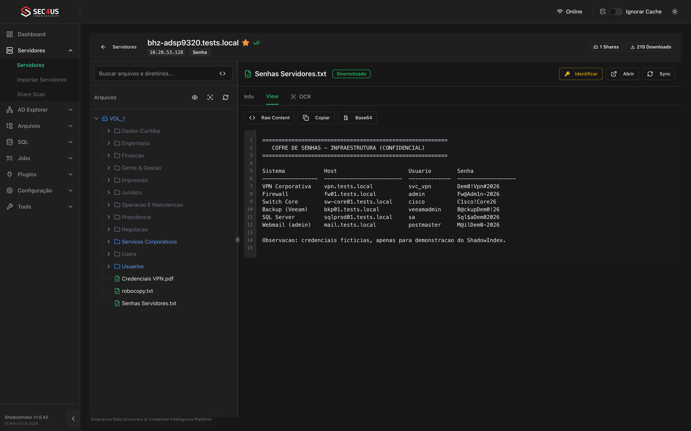
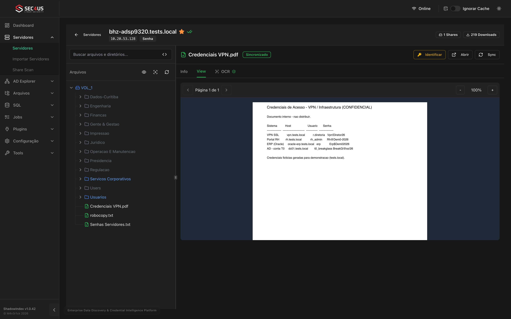

# Files (Browse, OCR and Offline)

[🏠 Home](Home) · [🇧🇷 Português](Arquivos-PT)

Browse a server's SMB shares, view file content and read the text extracted by
OCR.

## Local storage and offline viewing

All collected data — **downloaded files, their content and the OCR text** — is
**stored locally** (under `shadowindex_data/`). This lets you **view, search and
browse everything offline**, even when the source server is unavailable.

## What it shows

- **Share and directory tree** (e.g. `VOL_1`), with search by file or directory
  name and a "focus" mode on the selection.
- File panel with three tabs:
  - **Info** — UNC path, size, SHA-1 hash, MIME type, versions and status.
  - **View** — file content (raw text, Base64) and, for PDFs, the **built-in
    viewer**.
  - **OCR** — text extracted (via Tika) from documents and images.

### PDF viewing

## How to use

1. In **[Servers](Servers-EN)**, click a server to open the browser.
2. Expand a share (e.g. `VOL_1`) and navigate the folder tree.
3. Select a downloaded file to see **Info**, **View** and **OCR**.
4. Use **Identify** to manually register a leak on the file, or **Sync** to
   refresh/download the content.
5. Use search to locate files by name (e.g. `password`, `.pfx`).

## Related

- [Servers](Servers-EN) · [Leaks](Leaks-EN)
