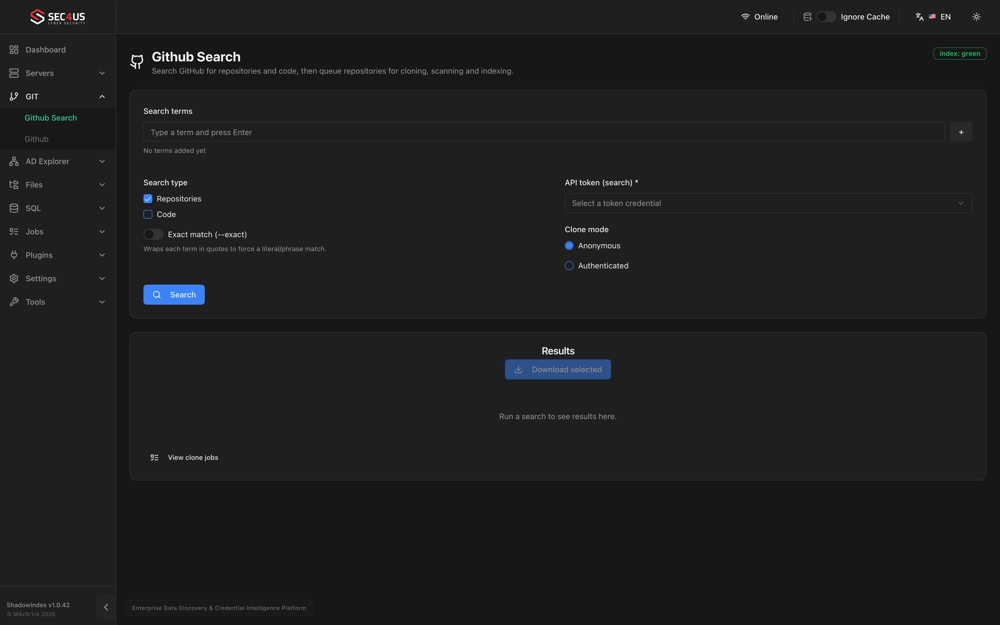
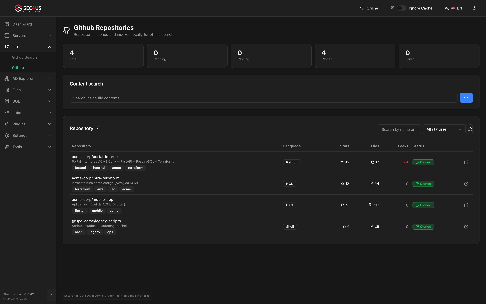
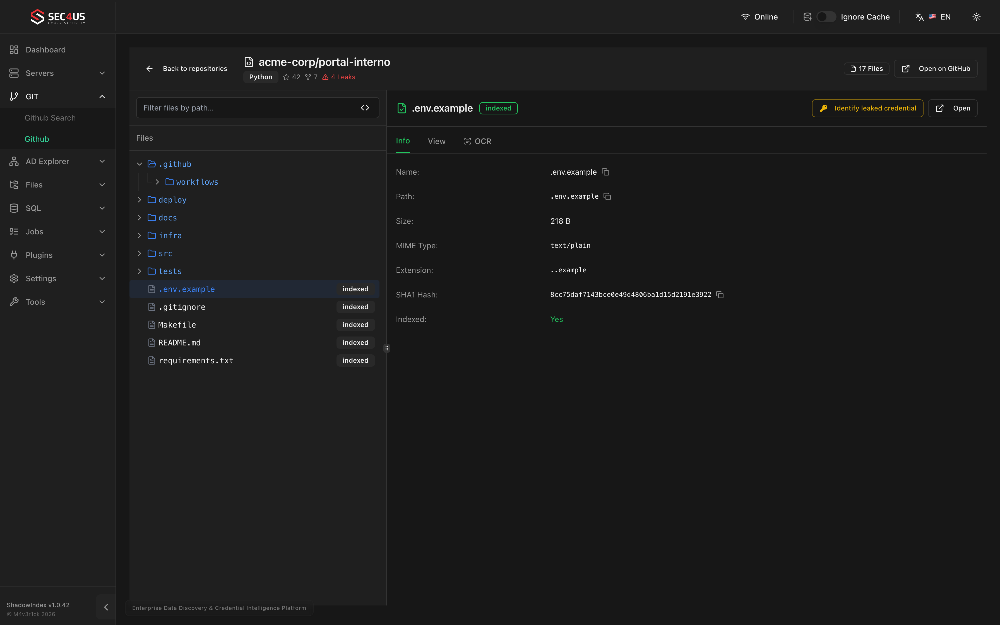
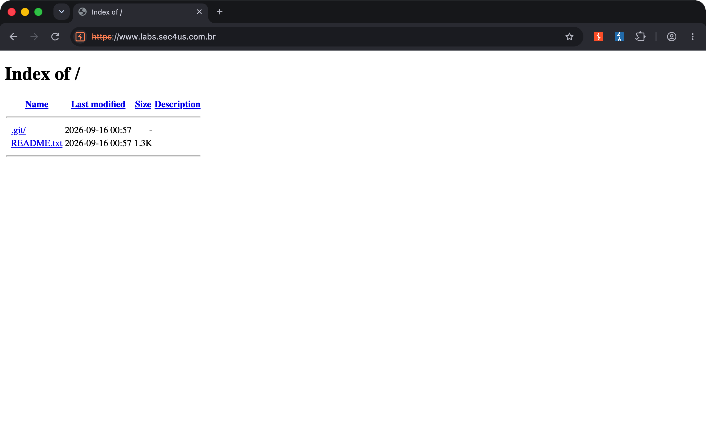
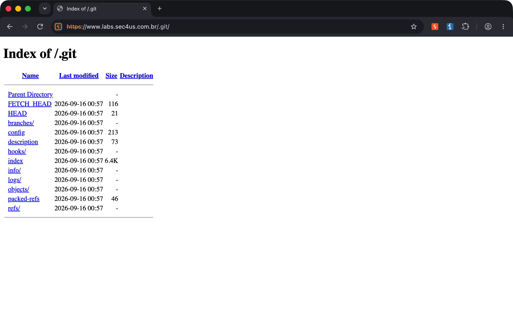
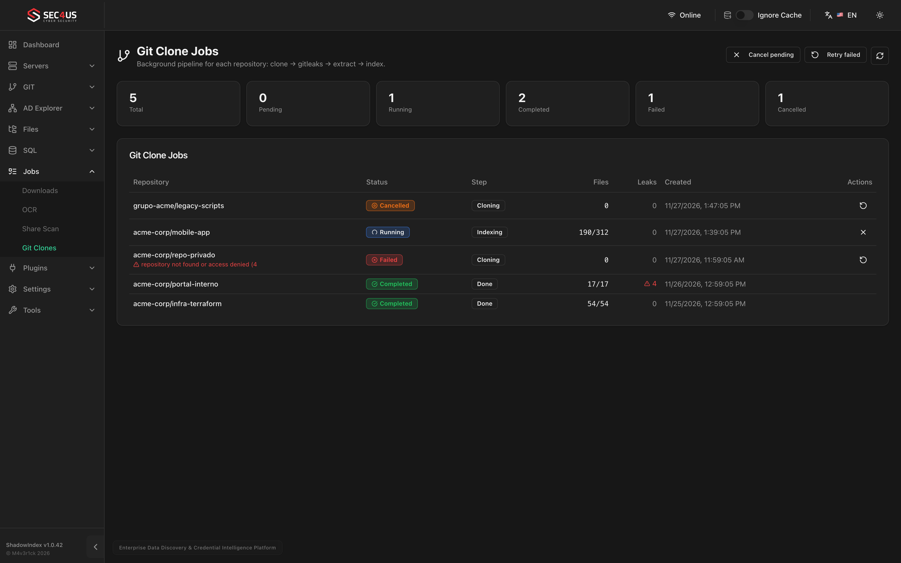
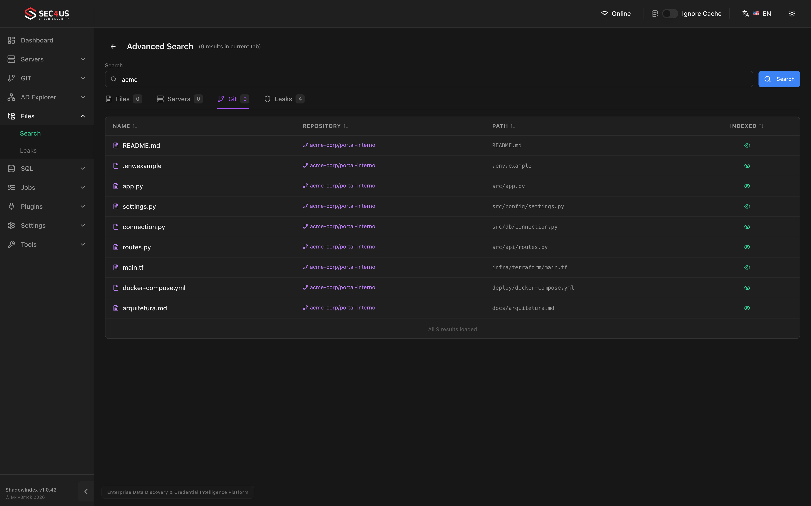

# GIT

[🏠 Home](Home) · [🇧🇷 Português](GIT-PT)

Search GitHub, register **instances** of Git platforms (GitHub/GitHub
Enterprise, GitLab, Gitea, Bitbucket, Azure DevOps), clone **any URL** (even an
**exposed `.git`** on the web via **Git Dump**), and run the same pipeline as SMB
files — **GitLeaks → OCR/text extraction → content indexing (OpenSearch)** — so
the source becomes searchable **offline**.

Cloning now indexes the **whole commit history** (all branches, filecrawler
style): every version of every file is searchable, including in old commits and
**deleted files** — where secrets are often forgotten. The browser lets you view
the **tree at a specific commit**, switch between **versions** of a file and open
the originating **commit** of a leak.

## Github Search



- Type **search terms** (press Enter to add each one as a chip) and pick the
  search **type**: Repositories and/or Code, with an optional **Exact match
  (`--exact`)** that forces a literal/phrase match.
- Pick a **token credential** for the GitHub Search API (**required**) and the
  **clone mode** — *anonymous* or *authenticated* (with a token, for private
  repos). Token credentials are managed in [Credentials](Credentials-EN).
- Running a search first returns the **number of repositories per condition**;
  select the ones you want and **Download** queues each repository into the
  clone pipeline.

## Repositories



- Lists repositories **cloned and indexed** locally, with the **origin platform
  logo** next to the name, language, **branches**, **commits**, stars, files,
  leaks and clone status.
- **Content search** finds text **inside the indexed files** (OpenSearch), with
  highlighted snippets; filter by name, tag, language or status. A **View Leaks**
  button jumps to that repo's findings.

## Git Instances (platforms)

Under **GIT → Instances** you register a Git platform **instance** to list and
clone **all projects** reachable by a token — great for **self-hosted** GitLab/
Gitea/Bitbucket/Azure.

- In **Add Instance**, enter the **URL** and mode (anonymous/authenticated with a
  token) and click **Test access**. Known public URLs go straight to standard
  APIs; on-premises are **fingerprinted** against known platform APIs to
  **auto-detect the platform**.
- The test runs a **whoami** (when supported) and **stores** the identity
  (read-only) — handy to confirm the token's privileges.
- Then **List projects** fetches **all** accessible projects/groups/subgroups
  (persisted in the DB, no re-fetch each time); in the table pick them one by one
  or **Download ALL** (supports thousands) — each enters the clone/index pipeline.

## Request Clone (clone any URL)

Under **GIT → Request Clone** you clone **on demand** any Git repository by URL
(any host, `https://` or `git@host:path`), with anonymous/authenticated mode and
optional **proxy**. **Test access** validates via `git ls-remote`; **Enqueue
clone** enters with **high priority**. It's the fast path for a single repo, or
for an **exposed `.git`** (below).

## Repository browser



- A **file tree** with expandable folders. Toggle between **Files** and
  **Commits** (GitHub-style list); clicking a commit opens the **whole tree at
  that commit** (like GitHub's `/tree/<sha>`). The **Open** button is
  **contextual** to the origin platform (GitHub/GitLab/…), or "Open URL".
- Opening a **file** shows **Info / View / OCR**: **View** has **syntax
  highlighting**, **line numbers** and **line highlighting** (leak deep-links open
  on the line, `#L173` style), with a per-line menu (copy line/URL, view on
  origin). The **Commit** block shows hash, author, date and **change type**; a
  **version selector** compares the file across commits.
- For **deleted files**, a **"View tree at previous commit"** button goes to the
  state where the file still existed. The **History** toggle includes paths that
  only existed in old/removed commits.
- **JWT**: when a secret is a JSON Web Token, the leak detail **decodes** it
  (header + claims) and checks the **expiry** (`exp`); already-expired JWTs have
  their **severity lowered**.

## Git Dump — rebuild a repo from an exposed `.git`

An **HTTP-accessible `.git/`** directory is one of the most critical findings on
a site: it holds the project's **entire source code and history** — all commits
and branches, and with them **secrets that were "removed"** in later commits
(tokens, passwords, keys). Because Git keeps every version in history, deleting a
secret in a new commit does **not** remove it from `.git`; whoever downloads the
repo recovers everything.

### Why it's critical even *without* directory listing

The "easy" case is a server with **directory listing** enabled, where you can
browse `.git/` in the browser:

| Site root exposes `.git/` | Exposed `.git/` contents |
|---|---|
|  |  |

But the real danger is that directory listing is **not required**. Git has a
**predictable** name layout (`HEAD`, `config`, `packed-refs`, `info/refs`,
`refs/heads/…`, `logs/…`, `objects/<xx>/<sha>`, `objects/pack/…`). As long as the
server **serves the files** from `.git/` (without listing them), the tool
**rebuilds the entire repository**: it reads `HEAD` and the refs to find the
commits, then walks the **objects** (following commit → tree → blobs and parents)
fetching each by its predictable path, plus the **packs**. In short: if
`…/.git/HEAD` returns **200**, the source leaks — with or without "Index of".

> Many servers serve the extension-less `.git/` files as `Content-Type:
> text/html`; Git Dump **does not trust the Content-Type** and uses the content
> (zlib objects, hex refs, `PACK` packs) so it won't discard valid data.

### Finding exposed `.git` (Google Dorks)

To **discover targets** with an exposed `.git` on the internet, use *Google
Dorks* — queries that exploit Git's predictable file names indexed by search
engines. Some examples:

```text
inurl:.git-credentials
inurl:.gitconfig
intext:"index of /.git" "parent directory"
filetype:git -github.com inurl:"/.git"
(intext:"index of /.git") ("parent directory")
inurl:ORIG_HEAD
intitle:"index of" ".gitignore"
".git" intitle:"Index of"
"Parent Directory" "Last modified" git
inurl:git
```

Once you find a candidate (e.g. `https://target.example/.git/`), just paste the
site URL into **Request Clone** — the system probes `.git/HEAD` and, if exposed,
rebuilds the repository (see below). Remember: the dump works even **without**
an "Index of"/directory listing; the dorks only help you *find* the most obvious
targets.

> Only use this against targets you are **authorized** to test.

### How to use it here

1. In **GIT → Request Clone**, enter the **site URL** (e.g.
   `https://target.example/` — no need to type `.git`).
2. Click **Test access**. If the URL isn't a normal git remote, the system
   **probes `…/.git/HEAD`** automatically. If an exposed `.git` is found, it shows
   **"Exposed .git directory detected"** and the clone mode becomes **dump**.
3. **Enqueue clone**: the tool downloads refs/objects/packs, runs `git checkout`
   to restore the tree, and produces a **valid git repository**.
4. The **normal pipeline** runs over it — **GitLeaks across the whole history** +
   content indexing — so secrets from any commit show up in [Leaks](Leaks-EN) and
   the code becomes searchable.

All dump requests (probe, refs, packs) are logged under **Audit → External
calls**; the thousands of objects are not audited individually to avoid noise.

## Clone queue (Jobs)



- Each queued repository becomes a **clone job** processed one by one:
  **clone → GitLeaks → text/OCR extraction → indexing**. States: *pending*,
  *running*, *completed*, *failed*, *cancelled* — with retry, cancel and
  prioritize actions.
- Clones land in the bind-mount (`./shadowindex_data/gitclones/<guid>`). Repos
  larger than a configurable threshold are cloned **shallow** (`--depth 1`);
  the download is **never skipped**.

## Advanced search — Git tab



- The global **Advanced Search** also covers **git files** (by path and by
  indexed content), in a dedicated **Git** tab, alongside Servers, Files and
  Leaks.

## Proxy, TLS and DNS

- Every search/clone screen has a **Proxy** field (*no proxy* or one of the
  system [Proxy Servers](Proxy-Servers-EN)), applied to the clone, `ls-remote`
  and API calls (socks5 supported).
- The system **ignores certificate failures** in every clone/search scenario
  (self-hosted/MITM/proxy with a custom cert).
- To resolve internal names (e.g. `gitlab.internal`), use **Settings → DNS**
  (`hostname → IP` overrides applied to `/etc/hosts`, valid for the whole
  backend). The screen has a **Diagnose** button that tests resolution and (TCP)
  reachability of the IP from inside the container.

## External-call auditing

Every HTTP request ShadowIndex makes to third parties (platform APIs, `.git`
dump) goes through a single helper and is logged under **Audit → External
calls**: provider, context, method, URL, **remote IP**, status, duration and the
bodies (with **secrets masked**). Records are kept permanently. The global
**User-Agent** is configurable in [Settings](Settings-EN).

## How to use

- **GitHub search**: in **Github Search**, add terms, pick the type and the API
  token, choose the clone mode and **Search** → select and **Download**.
- **Whole platform (self-hosted)**: in **Instances**, register the URL + token,
  **List projects** and **Download ALL** (or selected ones).
- **A specific URL / site with exposed `.git`**: in **Request Clone**, paste the
  URL, **Test access** (auto-detects the `.git` **dump**) and **Enqueue**.
- Follow progress under **Jobs → Git clones**; browse a repo under **GIT →
  Repositories**, use **Files/Commits**, open files (View with syntax
  highlighting) or run a **content search**.

## Related

- Secrets found in repositories appear in [Leaks](Leaks-EN), linked to the repo
  (with **View Leaks** per repo and *open in browser* that jumps to the right
  file, line and commit).
- Clone limits — shallow-clone threshold, simultaneous clones, max file size for
  indexing and the history-indexing caps — are configured in
  [Settings](Settings-EN).
