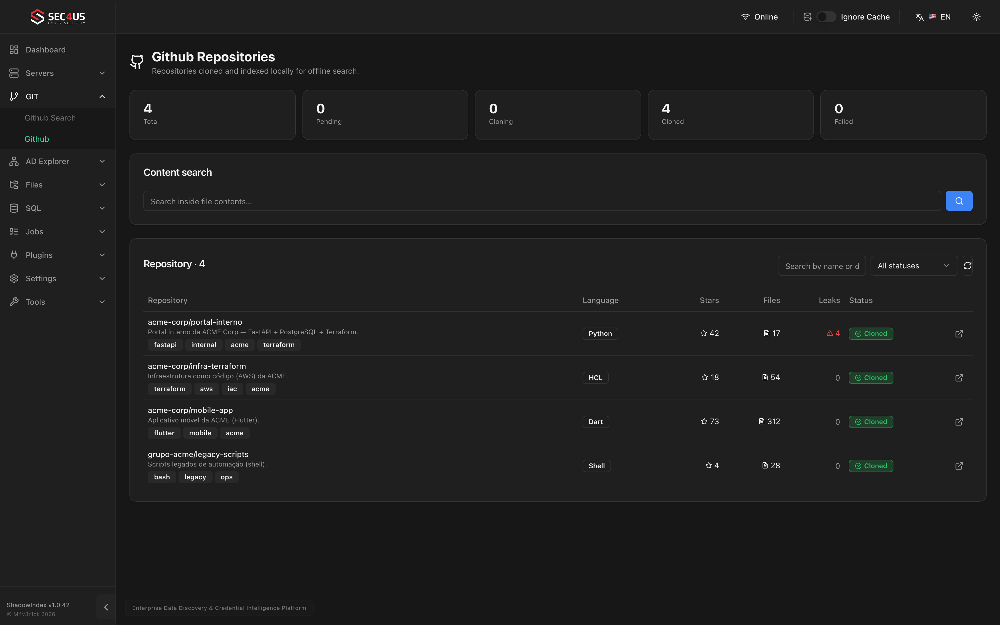

# GIT

[🏠 Início](Home) · [🇺🇸 English](GIT-EN)

Pesquise no GitHub, enfileire repositórios para clone e rode o mesmo pipeline
dos arquivos SMB — **GitLeaks → OCR/extração de texto → indexação de conteúdo
(OpenSearch)** — para que o código clonado fique pesquisável **offline**.

## Busca Github

- Digite os **termos de busca** (Enter adiciona cada um como um chip) e escolha
  o **tipo** de busca: Repositórios e/ou Código, com a opção **Correspondência
  exata (`--exact`)** que força a busca literal/por frase.
- Selecione uma **credencial do tipo token** para a API de busca do GitHub
  (**obrigatório**) e o **modo de clone** — *anônimo* ou *autenticado* (com
  token, para repos privados). Tokens são gerenciados em
  [Credenciais](Credenciais-PT).
- Ao buscar, primeiro retorna o **número de repositórios por condição**;
  selecione as desejadas e **Baixar** enfileira cada repositório no pipeline de
  clone.

## Github (repositórios)

- Lista os repositórios **clonados e indexados** localmente, com linguagem,
  estrelas, forks, topics, contagem de arquivos, leaks e status do clone.
- A **busca de conteúdo** encontra texto **dentro dos arquivos indexados**
  (OpenSearch), com trechos destacados; filtre a lista por nome, tag, linguagem
  ou status.

## Navegação no repositório

- Uma **árvore de arquivos** com pastas expansíveis, igual ao navegador de
  Servidores. Ao selecionar uma **pasta**, vê os objetos dela; ao selecionar um
  **arquivo**, abrem as abas **Info / View / OCR**, além de **Abrir** (no
  GitHub) e **Identificar credencial vazada**.
- **Info**: caminho, tamanho, MIME, extensão, SHA1 e status de indexação.
  **View**: conteúdo do arquivo. **OCR**: texto extraído de documentos/imagens/PDFs.

## Fila de clones (Jobs)

- Cada repositório enfileirado vira um **job de clone** processado um a um:
  **clone → GitLeaks → extração de texto/OCR → indexação**. Estados: *pendente*,
  *executando*, *concluído*, *falhou*, *cancelado* — com ações de repetir,
  cancelar e priorizar.
- Os clones ficam no bind-mount (`./shadowindex_data/gitclones/<guid>`). Repos
  maiores que um limiar configurável são clonados **rasos** (`--depth 1`); o
  download **nunca é pulado**.

## Busca avançada — aba Git

- A **Busca Avançada** global também cobre os **arquivos git** (por caminho e
  por conteúdo indexado), em uma aba **Git** dedicada, ao lado de Servidores,
  Arquivos e Leaks.

## Como usar

1. Em **Busca Github**, adicione os termos, escolha o tipo e o **token da API**,
   selecione o modo de clone e clique em **Buscar**.
2. Selecione as condições/repositórios e clique em **Baixar** para enfileirar.
3. Acompanhe o progresso em **Jobs → Clones Git** enquanto o pipeline roda.
4. Navegue um repositório em **GIT → Github**, abra arquivos e veja as abas
   **Info/View/OCR**, ou faça uma **busca de conteúdo**.

## Relacionado

- Segredos encontrados nos repositórios aparecem em [Leaks](Leaks-PT), ligados
  ao repositório (com um botão *abrir no navegador* que já abre o arquivo).
- Os limites de clone — limiar de clone raso, clones simultâneos e tamanho
  máximo de arquivo para indexação — são configurados em
  [Configurações](Configuracoes-PT).
