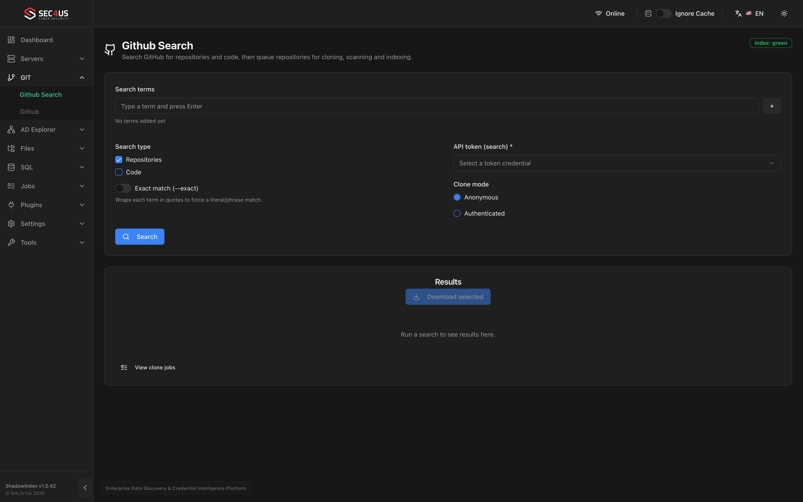
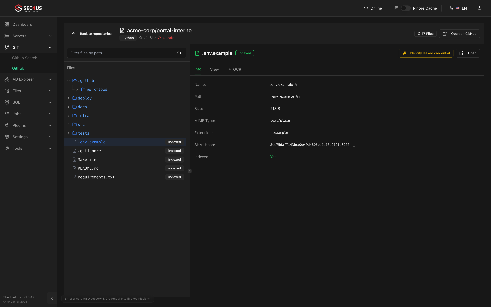
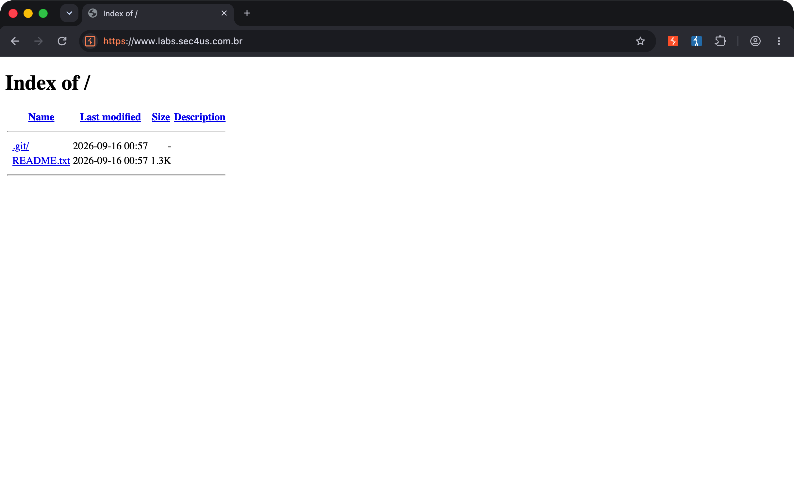
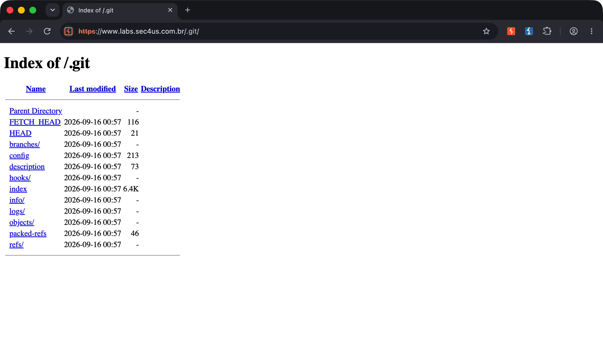
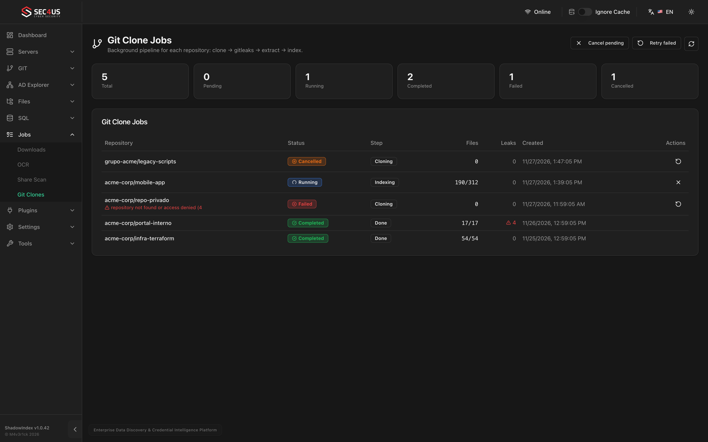
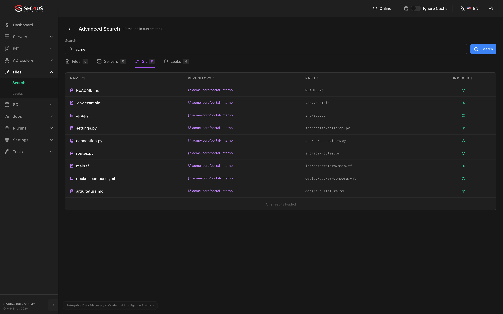

# GIT

[🏠 Início](Home) · [🇺🇸 English](GIT-EN)

Pesquise no GitHub, cadastre **instâncias** de plataformas Git (GitHub/GitHub
Enterprise, GitLab, Gitea, Bitbucket, Azure DevOps), clone **qualquer URL** (até
um **`.git` exposto** na web via **Git Dump**) e rode o mesmo pipeline dos
arquivos SMB — **GitLeaks → OCR/extração de texto → indexação de conteúdo
(OpenSearch)** — para que o código fique pesquisável **offline**.

O clone agora indexa **todo o histórico de commits** (todas as branches, estilo
filecrawler): cada versão de cada arquivo fica pesquisável, inclusive em commits
antigos e **arquivos removidos** — é onde credenciais costumam ficar esquecidas.
A navegação permite ver a **árvore em um commit específico**, alternar entre
**versões** de um arquivo e abrir o **commit** de origem de um leak.

## Busca Github



- Digite os **termos de busca** (Enter adiciona cada um como um chip) e escolha
  o **tipo** de busca: Repositórios e/ou Código, com a opção **Correspondência
  exata (`--exact`)** que força a busca literal/por frase.
- Selecione uma **credencial do tipo token** para a API de busca do GitHub
  (**obrigatório**) e o **modo de clone** — *anônimo* ou *autenticado* (com
  token, para repos privados). Tokens são gerenciados em
  [Credenciais](Credenciais-PT).
- Ao buscar, primeiro retorna o **número de repositórios por condição**;
  selecione as desejadas e **Baixar** enfileira cada repositório no pipeline de
  clone.

## Repositórios


- Lista os repositórios **clonados e indexados** localmente, com o **logo da
  plataforma de origem** (GitHub/GitLab/Azure/Bitbucket) ao lado do nome,
  linguagem, **branches**, **commits**, estrelas, arquivos, leaks e status.
- A **busca de conteúdo** encontra texto **dentro dos arquivos indexados**
  (OpenSearch), com trechos destacados; filtre a lista por nome, tag, linguagem
  ou status. Um botão **Ver Leaks** leva direto aos vazamentos daquele repo.

## Instâncias Git (plataformas)

Em **GIT → Instances** você cadastra uma **instância** de plataforma Git para
listar e clonar **todos os projetos** acessíveis por um token — útil para
GitLab/Gitea/Bitbucket/Azure **self-hosted** (on-premises).

- Em **Add Instance**, informe a **URL** e o modo (anônimo/autenticado com
  token) e clique em **Testar acesso**. Para URLs públicas conhecidas vai direto
  às APIs padrão; para on-premises o sistema faz o **fingerprint** das APIs
  conhecidas para **identificar a plataforma** automaticamente.
- O teste roda um **whoami** (quando suportado) e **armazena** a identidade
  (read-only) na instância — ótimo para confirmar privilégios do token.
- Depois, **Listar projetos** busca **todos** os projetos/grupos/subgrupos
  acessíveis (persistidos no banco, sem refazer a cada vez) e, na tabela, você
  seleciona um a um ou **Baixar TODOS** (suporta milhares) — cada projeto entra
  no mesmo pipeline de clone e indexação.

## Request Clone (clonar qualquer URL)

Em **GIT → Request Clone** você clona **sob demanda** qualquer repositório Git
informando a URL (qualquer host, `https://` ou `git@host:caminho`), com modo
anônimo/autenticado e **proxy** opcional. **Testar acesso** valida via
`git ls-remote`; **Enfileirar clone** entra com **prioridade alta** (fura a
fila). É o caminho rápido para um repositório específico, ou para um **`.git`
exposto** (veja abaixo).

## Navegação no repositório



- Uma **árvore de arquivos** com pastas expansíveis. Alterne entre **Arquivos**
  e **Commits** (lista estilo GitHub); clicar num commit abre a **árvore inteira
  naquele commit** (como `/tree/<sha>` do GitHub). O botão **Abrir** é
  **contextual** pela plataforma de origem (GitHub/GitLab/…), ou "Abrir URL".
- Ao abrir um **arquivo**, as abas **Info / View / OCR**: o **View** tem
  **destaque de sintaxe**, **numeração de linhas** e **realce da linha** (os
  deep-links de leak já abrem na linha, estilo `#L173`), com menu por linha
  (copiar linha/URL, ver na origem). O bloco **Commit** mostra hash, autor, data
  e **tipo de alteração**; um **seletor de versões** permite comparar o arquivo
  entre commits.
- Para **arquivos removidos**, um botão **"Ver árvore no commit anterior"** leva
  ao estado onde o arquivo ainda existia. O toggle **Histórico** inclui na árvore
  os caminhos que só existiram em commits antigos/removidos.
- **JWT**: quando um segredo é um JSON Web Token, o detalhe do leak o
  **decodifica** (header + claims) e checa a **validade** (`exp`); JWTs já
  expirados têm a **criticidade reduzida**.

## Git Dump — reconstruir repositório de um `.git` exposto

Um diretório **`.git/` acessível via HTTP** é um dos achados mais críticos em um
site: ele contém **todo o código-fonte e o histórico** do projeto — todos os
commits e branches, e com eles **segredos que foram "removidos"** em commits
posteriores (tokens, senhas, chaves). Como o Git guarda cada versão no histórico,
apagar um segredo em um commit novo **não o remove** do `.git`; quem baixa o
repositório recupera tudo.

### Por que é crítico mesmo *sem* listagem de diretório

O caso "fácil" é quando o servidor tem **directory listing** ligado e dá para
navegar o `.git/` pelo navegador:

| Raiz do site expõe o `.git/` | Conteúdo do `.git/` exposto |
|---|---|
|  |  |

Mas o perigo real é que **não é preciso** haver listagem de diretório. O Git tem
uma estrutura de nomes **previsível** (`HEAD`, `config`, `packed-refs`,
`info/refs`, `refs/heads/…`, `logs/…`, `objects/<xx>/<sha>`, `objects/pack/…`).
Basta o servidor **servir os arquivos** do `.git/` (sem precisar listá-los) para
que a ferramenta **reconstrua o repositório inteiro**: ela lê o `HEAD` e as refs
para descobrir os commits, e então percorre os **objetos** (seguindo
commit → árvore → blobs e pais) baixando cada um pelo caminho previsível, além
dos **packs**. Ou seja: se `…/.git/HEAD` responder **200**, o código vaza —
tendo ou não "Index of".

> Muitos servidores entregam os arquivos sem extensão do `.git/` com
> `Content-Type: text/html`; o Git Dump **não confia no Content-Type** e usa o
> conteúdo (objetos zlib, refs em hex, packs `PACK`) para não descartar dados
> válidos.

### Encontrando `.git` expostos (Google Dorks)

Para **descobrir alvos** com `.git` exposto na internet, use *Google Dorks* —
consultas que exploram os nomes previsíveis do Git indexados por buscadores.
Alguns exemplos:

```text
inurl:.git-credentials
inurl:.gitconfig
intext:"index of /.git" "parent directory"
filetype:git -github.com inurl:"/.git"
(intext:"index of /.git") ("parent directory")
inurl:ORIG_HEAD
intitle:"index of" ".gitignore"
".git" intitle:"Index of"
"Parent Directory" "Last modified" git
inurl:git
```

E com o **Shodan**, para encontrar servidores que expõem o diretório `.git`:

```text
http.title:"index of /.git"
```

Depois de encontrar um candidato (ex.: `https://alvo.exemplo/.git/`), basta
passar a URL do site em **Request Clone** — o sistema sonda o `.git/HEAD` e, se
exposto, reconstrói o repositório (veja abaixo). Lembre: o dump funciona mesmo
**sem** "Index of"/listagem de diretório; os dorks apenas ajudam a *achar* os
alvos mais óbvios.

> Use apenas em alvos para os quais você tem **autorização**.

### Como usar aqui

1. Em **GIT → Request Clone**, informe a **URL do site** (ex.:
   `https://alvo.exemplo/` — não precisa digitar o `.git`).
2. Clique em **Testar acesso**. Se a URL não for um remote git normal, o sistema
   **sonda `…/.git/HEAD`** automaticamente. Havendo um `.git` exposto, aparece
   **"Diretório .git exposto detectado"** e o modo de clone vira **dump**.
3. **Enfileirar clone**: a ferramenta baixa refs/objetos/packs, faz
   `git checkout` para restaurar a árvore e entrega um **repositório git válido**.
4. O **pipeline normal** roda sobre ele — **GitLeaks em todo o histórico** +
   indexação de conteúdo — então os segredos de qualquer commit aparecem em
   [Leaks](Leaks-PT), e o código fica pesquisável.

Todas as requisições do dump (sonda, refs, packs) ficam registradas em
**Auditoria → Chamadas externas**; os milhares de objetos não são auditados um a
um para não poluir a trilha.

## Fila de clones (Jobs)



- Cada repositório enfileirado vira um **job de clone** processado um a um:
  **clone → GitLeaks → extração de texto/OCR → indexação**. Estados: *pendente*,
  *executando*, *concluído*, *falhou*, *cancelado* — com ações de repetir,
  cancelar e priorizar.
- Os clones ficam no bind-mount (`./shadowindex_data/gitclones/<guid>`). Repos
  maiores que um limiar configurável são clonados **rasos** (`--depth 1`); o
  download **nunca é pulado**.

## Busca avançada — aba Git



- A **Busca Avançada** global também cobre os **arquivos git** (por caminho e
  por conteúdo indexado), em uma aba **Git** dedicada, ao lado de Servidores,
  Arquivos e Leaks.

## Como usar

- **Busca no GitHub**: em **Busca Github**, adicione termos, escolha o tipo e o
  token da API, selecione o modo de clone e **Buscar** → selecione e **Baixar**.
- **Plataforma inteira (self-hosted)**: em **Instances**, cadastre a URL + token,
  **Liste projetos** e **Baixe TODOS** (ou selecionados).
- **Uma URL específica / site com `.git` exposto**: em **Request Clone**, cole a
  URL, **Teste o acesso** (detecta o **dump** de `.git` automaticamente) e
  **Enfileire**.
- Acompanhe em **Jobs → Clones Git**; navegue o repositório em **GIT →
  Repositórios**, use **Arquivos/Commits**, abra arquivos (View com destaque de
  sintaxe) ou faça **busca de conteúdo**.

## Proxy, TLS e DNS

- Todas as telas de busca/clone têm um campo **Proxy** (*sem proxy* ou um dos
  [Proxy Servers](Proxy-Servers-PT) do sistema), aplicado ao clone, ao
  `ls-remote` e às chamadas de API (socks5 suportado).
- O sistema **ignora falhas de certificado** em todo cenário de clone/busca
  (hosts self-hosted/MITM/proxy com cert próprio).
- Para resolver nomes internos (ex.: `gitlab.interno`), use
  **Configurações → DNS** (overrides `hostname → IP` aplicados no `/etc/hosts`,
  válidos para todo o backend). A tela tem um **Diagnóstico** que testa a
  resolução e o alcance (TCP) do IP de dentro do container.

## Auditoria de chamadas externas

Toda requisição HTTP que o ShadowIndex faz a terceiros (APIs de plataforma, dump
de `.git`) passa por um helper único e é registrada em
**Auditoria → Chamadas externas**: provedor, contexto, método, URL, **IP
remoto**, status, duração e os corpos (com **segredos mascarados**). Os registros
são mantidos permanentemente. O **User-Agent** global é configurável em
[Configurações](Configuracoes-PT).

## Relacionado

- Segredos encontrados nos repositórios aparecem em [Leaks](Leaks-PT), ligados
  ao repositório (com **Ver Leaks** por repo e *abrir no navegador* que já abre
  o arquivo na linha e no commit certos).
- Os limites de clone — limiar de clone raso, clones simultâneos, tamanho máximo
  de arquivo para indexação e os tetos de indexação de histórico — são
  configurados em [Configurações](Configuracoes-PT).
