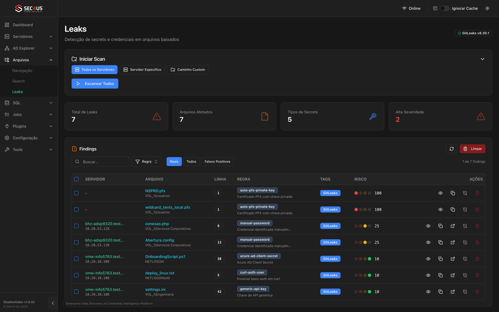

# Leaks

[🏠 Home](Home) · [🇧🇷 Português](Leaks-PT)

Detection of **secrets and credentials** in downloaded files, using **GitLeaks**
over the content and the OCR text.

## What it shows

- Summary cards: **total leaks**, **affected files**, **secret types** and how
  many are **high severity**.
- A *findings* table with: server, file, line, **rule** (e.g.
  `auto-pfx-private-key`, `manual-password`, `azure-ad-client-secret`), **tags**
  and **risk** (colored indicators + score).
- Filters by **rule**, by **real / all / false positives** and free-text search.

## How to use

1. In **Start Scan**, pick the scope: **All Servers**, **Specific Server** or
   **Custom Path**.
2. Click **Scan** and watch the findings appear.
3. Mark items as **false positive** to refine the results.
4. Open the related file in the **[Browser](Files-EN)** to see the context.

> PFX certificates and private keys are detected automatically when viewing the
> file.
