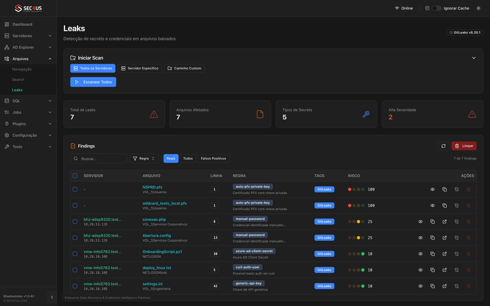

# Leaks

[🏠 Início](Home) · [🇺🇸 English](Leaks-EN)

Detecção de **secrets e credenciais** nos arquivos baixados, usando o
**GitLeaks** sobre o conteúdo e o texto de OCR.

## O que mostra

- Cartões de resumo: **total de leaks**, **arquivos afetados**, **tipos de
  secrets** e quantos são de **alta severidade**.
- Tabela de *findings* com: servidor, arquivo, linha, **regra** (ex.:
  `auto-pfx-private-key`, `manual-password`, `azure-ad-client-secret`), **tags**
  e **risco** (indicadores coloridos + score).
- Filtros por **regra**, por **reais / todos / falsos positivos** e busca livre.

## Como usar

1. Em **Iniciar Scan**, escolha o escopo: **Todos os Servidores**, **Servidor
   Específico** ou **Caminho Custom**.
2. Clique em **Escanear** e acompanhe os findings aparecerem.
3. Marque itens como **falso positivo** para refinar os resultados.
4. Abra o arquivo relacionado no **[Browse](Arquivos-PT)** para ver o contexto.

> Certificados PFX e chaves privadas são detectados automaticamente ao
> visualizar o arquivo.
