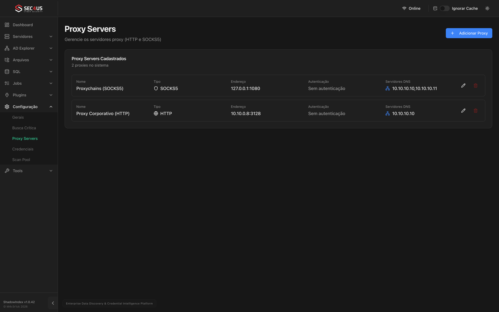

# Proxy Servers

[🏠 Home](Home) · [🇧🇷 Português](Proxy-Servers-PT)

Configure proxies to reach the target network through a tunnel — for example via
**Proxychains/SOCKS5** or a corporate **HTTP** proxy.

## What it shows

- List of registered proxies with **type** (`socks5` or `http`), **IP/port** and
  **DNS** servers reachable through the tunnel.
- Optional association with a **[credential](Credentials-EN)** (user/password)
  for authenticated proxies.

## Types

- **SOCKS5 (Proxychains)** — forwards traffic through a SOCKS tunnel, useful to
  pivot into internal networks.
- **HTTP** — HTTP/HTTPS proxy (e.g. a corporate egress proxy).

## How to use

1. Register the proxy with its **type**, **IP** and **port**.
2. Provide the target network **DNS servers** to resolve names through the tunnel.
3. (Optional) Associate a credential for proxies that require authentication.
4. Bind the proxy to a **plugin instance** so scans and downloads use the tunnel
   when reaching the servers.
