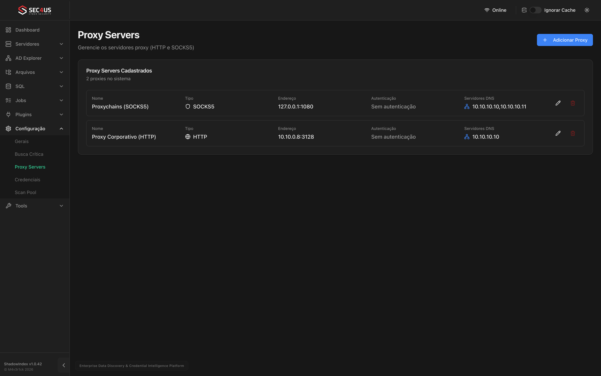

# Proxy Servers

[🏠 Início](Home) · [🇺🇸 English](Proxy-Servers-EN)

Configure proxies para alcançar a rede alvo através de um túnel — por exemplo,
via **Proxychains/SOCKS5** ou um proxy **HTTP** corporativo.

## O que mostra

- Lista de proxies cadastrados com **tipo** (`socks5` ou `http`), **IP/porta** e
  servidores **DNS** acessíveis pelo túnel.
- Associação opcional a uma **[credencial](Credenciais-PT)** (usuário/senha) para
  proxies autenticados.

## Tipos

- **SOCKS5 (Proxychains)** — encaminha o tráfego por um túnel SOCKS, útil para
  pivotar para redes internas.
- **HTTP** — proxy HTTP/HTTPS (ex.: proxy corporativo de saída).

## Como usar

1. Cadastre o proxy informando **tipo**, **IP** e **porta**.
2. Informe os **DNS servers** da rede alvo para resolver nomes pelo túnel.
3. (Opcional) Associe uma credencial para proxies que exigem autenticação.
4. Vincule o proxy a uma **instância de plugin** para que os scans e downloads
   usem o túnel ao acessar os servidores.
