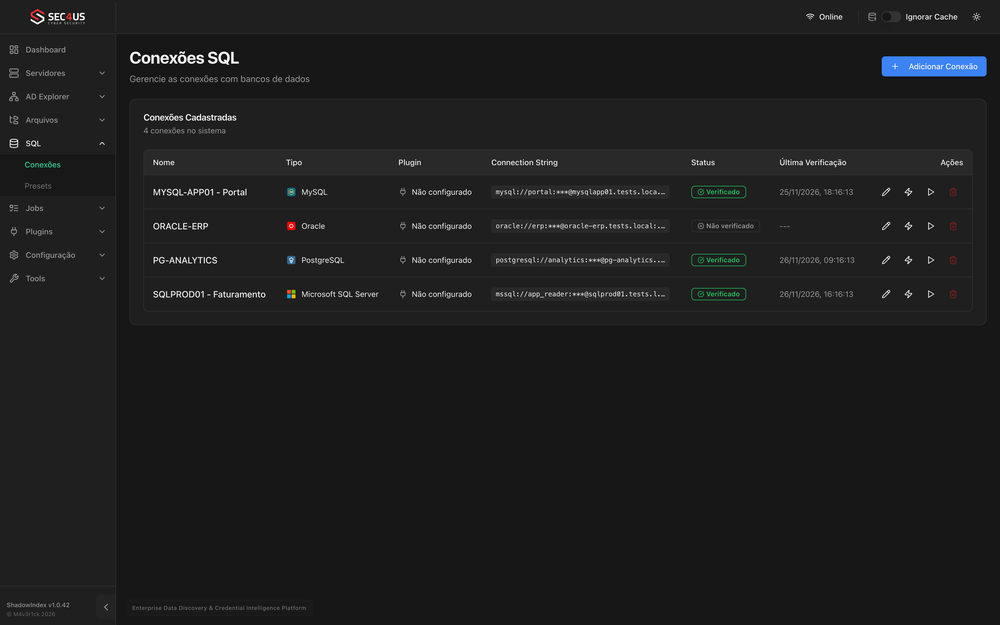

# SQL

[🏠 Home](Home) · [🇧🇷 Português](SQL-PT)

Connect to discovered databases and run **enumeration** and data-collection
queries.



## What it shows

- Registered **connections**, each with a database **type** (MS-SQL, MySQL,
  PostgreSQL, Oracle, MariaDB, MongoDB, SQLite) and verification status.
- SQL command **presets** per database type (ready-made queries).
- **History** of executed queries, with result, execution time and status.

## How to use

1. Create a **connection** with its type and connection string (you can use a
   [credential](Credentials-EN) and a [proxy](Proxy-Servers-EN)).
2. Verify the connection.
3. Run a query — manually or from a **preset** (e.g. list databases, logins,
   tables).
4. Check the **history** to review previous enumerations and their results.

### Enumeration examples

```sql
SELECT name FROM sys.databases ORDER BY name;                  -- databases (MS-SQL)
SELECT name FROM sys.server_principals WHERE type IN ('S','U'); -- logins
SELECT TABLE_SCHEMA, TABLE_NAME FROM INFORMATION_SCHEMA.TABLES; -- tables
```
