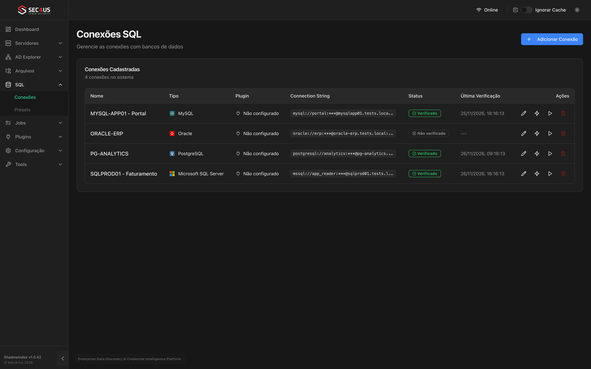

# SQL

[🏠 Início](Home) · [🇺🇸 English](SQL-EN)

Conecte-se a bancos de dados descobertos e execute consultas de **enumeração** e
coleta de dados.



## O que mostra

- **Conexões** cadastradas, cada uma com um **tipo** de banco (MS-SQL, MySQL,
  PostgreSQL, Oracle, MariaDB, MongoDB, SQLite) e status de verificação.
- **Presets** de comandos SQL por tipo de banco (consultas prontas).
- **Histórico** de queries executadas, com resultado, tempo de execução e status.

## Como usar

1. Crie uma **conexão** informando o tipo e a *connection string* (pode usar uma
   [credencial](Credenciais-PT) e um [proxy](Proxy-Servers-PT)).
2. Verifique a conexão.
3. Execute uma query — manualmente ou a partir de um **preset** (ex.: listar
   bancos, usuários/logins, tabelas).
4. Consulte o **histórico** para revisar enumerações anteriores e seus
   resultados.

### Exemplos de enumeração

```sql
SELECT name FROM sys.databases ORDER BY name;                 -- bancos (MS-SQL)
SELECT name FROM sys.server_principals WHERE type IN ('S','U'); -- logins
SELECT TABLE_SCHEMA, TABLE_NAME FROM INFORMATION_SCHEMA.TABLES; -- tabelas
```
