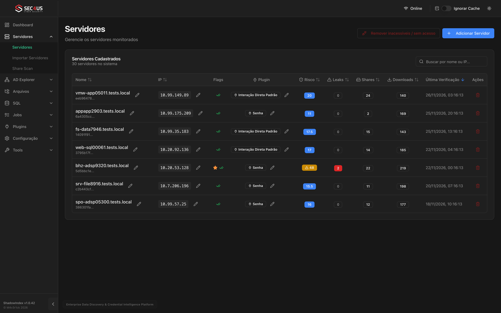

# Servers

[🏠 Home](Home) · [🇧🇷 Português](Servidores-PT)

Inventory of monitored servers, with a risk index and exposure indicators.

## What it shows

- List of registered servers with **IP**, access **plugin** (e.g. *Password*,
  *Direct Interaction*), **last check** and flags (favorite, reachable/unreachable).
- Per-server exposure columns:
  - **Risk** — 0–100 index computed from leaks, shares and downloads.
  - **Leaks** — number of secrets/credentials found.
  - **Shares** — discovered shares.
  - **Downloads** — downloaded/indexed files.

## How to use

1. **Add Server** — register manually, or use **Import Servers** (Nmap XML, a list
   of IPs/names, or a BloodHound import).
2. Click a server to open the **[Files browser](Files-EN)**.
3. Mark servers as **favorites** (⭐) for quick access.
4. Use **Remove unreachable / no access** to clean up hosts without connectivity.
5. Sort by columns (Risk, Leaks, Shares...) to prioritize your analysis.

## Related

- [Files](Files-EN) · [Leaks](Leaks-EN) · [Credentials](Credentials-EN)
