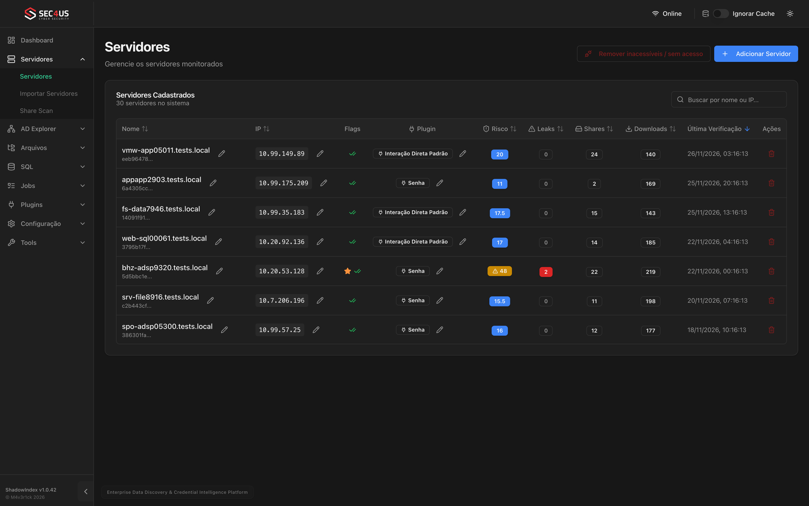

# Servidores

[🏠 Início](Home) · [🇺🇸 English](Servers-EN)

Inventário dos servidores monitorados, com índice de risco e indicadores de
exposição.

## O que mostra

- Lista de servidores cadastrados com **IP**, **plugin** de acesso
  (ex.: *Senha*, *Interação Direta*), **última verificação** e flags (favorito,
  acessível/inacessível).
- Colunas de exposição por servidor:
  - **Risco** — índice 0–100 calculado a partir de leaks, shares e downloads.
  - **Leaks** — quantidade de secrets/credenciais encontrados.
  - **Shares** — compartilhamentos descobertos.
  - **Downloads** — arquivos baixados/indexados.

## Como usar

1. **Adicionar Servidor** — cadastre manualmente, ou use **Importar Servidores**
   (Nmap XML, lista de IPs/nomes ou importação de BloodHound).
2. Clique em um servidor para abrir o **[Browse de arquivos](Arquivos-PT)**.
3. Marque servidores como **favoritos** (⭐) para acesso rápido.
4. Use **Remover inacessíveis / sem acesso** para limpar hosts sem conectividade.
5. Ordene pelas colunas (Risco, Leaks, Shares...) para priorizar a análise.

## Relacionado

- [Arquivos](Arquivos-PT) · [Leaks](Leaks-PT) · [Credenciais](Credenciais-PT)
