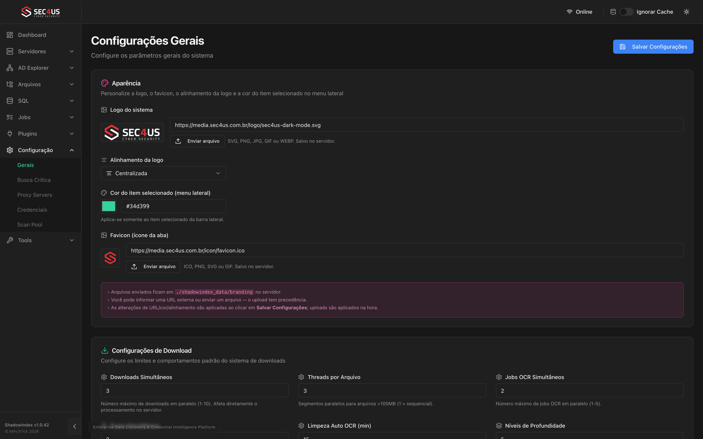

# Settings

[🏠 Home](Home) · [🇧🇷 Português](Configuracoes-PT)

General system parameters — appearance, downloads, OCR and integrations.

## Sections

- **Appearance** — system logo, favicon, **logo alignment** and the selected item
  color in the side menu. Uploads are stored under `shadowindex_data/branding`.
- **Download** — simultaneous downloads, threads per file, simultaneous OCR jobs,
  maximum size and ignored extensions.
- **OCR / Indexing** — enable automatic OCR, included/excluded extensions and MIME
  types, raw-content auto-indexing.
- Subpages: **[Critical Search](Leaks-EN)**, **[Proxy Servers](Proxy-Servers-EN)**,
  **[Credentials](Credentials-EN)** and **Scan Pool** (share-scan concurrency and
  filters).

## How to use

1. Adjust the desired fields.
2. Click **Save Settings** (logo/favicon uploads apply immediately; URLs/color/
   alignment apply on save).
